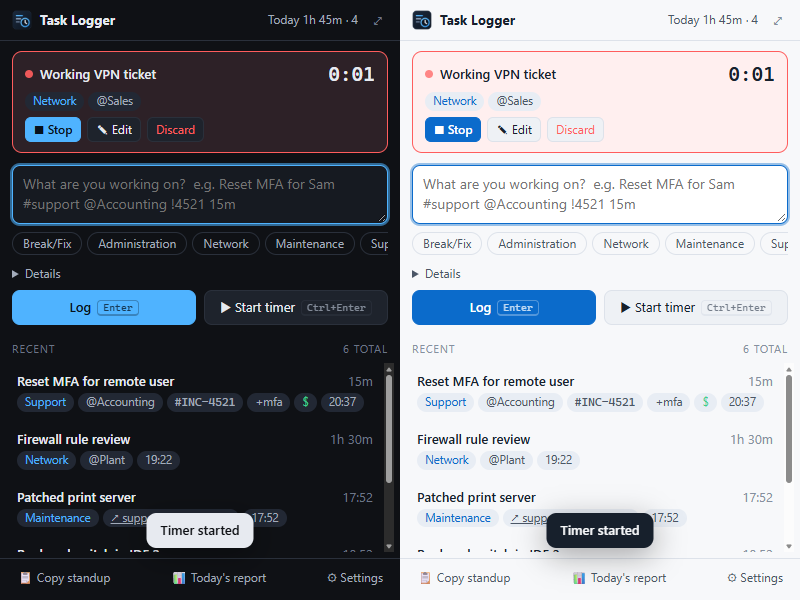
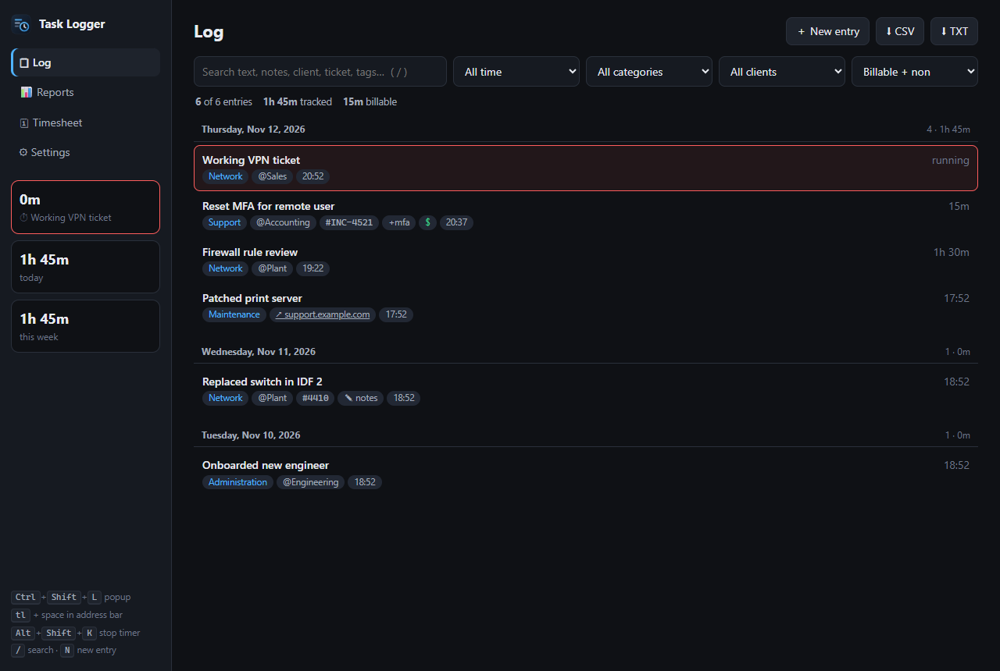
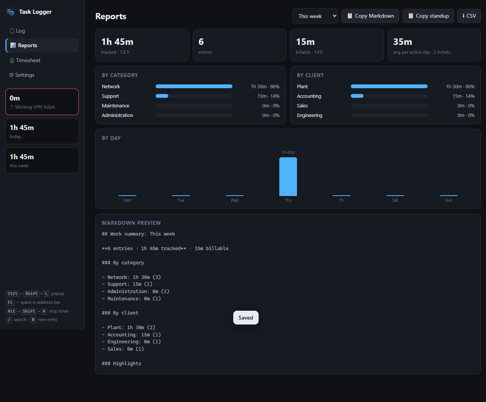
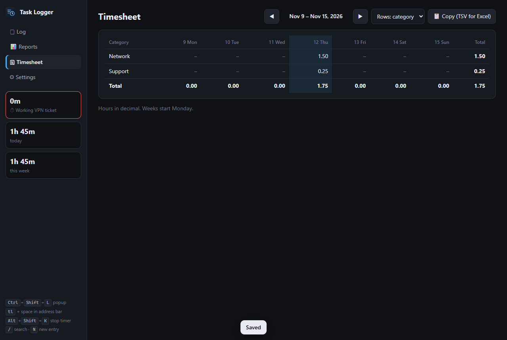

# Quick Task Logger

A keyboard-first work log and timer for IT pros, as a Chrome / Edge extension (Manifest V3).
Log what you did in about two seconds, then turn it into a timesheet, a standup or a manager report.
Your data stays in your browser profile.



## What's new in v3

v3 is a rewrite of the v2 "MSP Edition".

| v2 problem | v3 |
| --- | --- |
| All tasks lived in one `chrome.storage.sync` key (8 KB limit), so logging **silently stopped after ~30-50 tasks** | Unlimited `chrome.storage.local`. v2 data is migrated automatically on update and the old copy is left untouched as a safety net |
| A task was just a timestamp, with no duration | Durations (`45m`, `1h30`, `1:15`) plus a start/stop **timer** with a live toolbar badge |
| Six fields to fill in | **One-line quick entry**: `Reset MFA #support @Accounting !4521 15m +mfa $` |
| Ticket numbers typed by hand | **Auto-detected from the current tab**: Freshservice, ServiceDesk Plus, Zendesk, ConnectWise, Autotask, HaloPSA, Jira, ServiceNow, GitHub, plus your own regexes |
| The popup rendered task text as raw HTML (HTML injection), and link schemes weren't checked | No HTML sinks at all, http(s)-only links, strict extension CSP, and CSV formula-injection guarding |
| Had to open the popup to log | Address bar (`tl ` + text), right-click "Log this page / selection / link", and keyboard shortcuts |
| Export only | **Reports** (by category, client and day), a **weekly timesheet** (copies straight into Excel), a **standup generator**, plus JSON backup and JSON/CSV import |
| No way to fix a mistake | Edit dialog, undo on delete, start a past task again with one click |

## Features

**Logging**

- **Quick entry:** one line, parsed as you type.
  - `#category` matches fuzzily, so `#breakfix` becomes Break/Fix.
  - `@client` (or department), `!ticket`, `+tag`, a duration, `$` for billable, and a URL become the task's fields.
  - Quote multi-word values: `@"Acme Corp"`.
- **Timer:** `Ctrl+Enter` starts one (any running timer stops first). `Alt+Shift+K` stops it from anywhere. The toolbar badge shows elapsed minutes.
- **Context:** "📎 This tab" attaches the current page. The ticket number fills itself in when the tab is a ticket.
- **Drafts:** a half-typed entry survives closing the popup.
- **Reminders (optional):** a "What are you working on?" nudge during work hours when nothing has been logged. Skipped while a timer runs; one click to snooze.

**Review**

- **Dashboard log:** grouped by day. Search everything with `/`; filter by date range, category, client and billable.
- **Reports:** totals, billable %, average per day, bars by category and client, a column chart by day, and a Markdown summary you can copy.
- **Timesheet:** a Monday-to-Sunday grid of decimal hours, with rows by category, client or ticket. Optional rounding of each entry (6, 15 or 30 min). Copy as TSV and paste into Excel.
- **Standup:** one click copies "Yesterday / Today / Blockers". "Yesterday" is the previous workday, so on Monday it reads Friday.

**Data**

- CSV and TXT export of the filtered view, plus a full JSON backup.
- Import JSON backups, v3 CSV or the **v2 CSV export**. Duplicates are skipped.
- Themes: Auto (follows the OS), Dark, Light, Matrix.





## Install

1. Clone or download this repo.
2. Open `chrome://extensions` (or `edge://extensions`) and turn on **Developer mode**.
3. Click **Load unpacked** and select the repo folder (the one with `manifest.json`).
4. Optional: pin the icon. If a shortcut doesn't fire, set it in `chrome://extensions/shortcuts`; another extension may already own the key.

Upgrading from v2: load v3 over the same folder, or use **Reload** on the existing extension. Your tasks and categories migrate automatically. To move data from a different browser or profile, export CSV in v2 and import it in v3 under Settings → Data.

## Shortcuts

| Where | Keys | Action |
| --- | --- | --- |
| Anywhere | `Ctrl+Shift+L` (`⌘⇧L`) | Open the popup |
| Anywhere | `Alt+Shift+K` | Stop the running timer |
| Anywhere | `Alt+Shift+L` | Open the dashboard |
| Address bar | `tl` + `Space` + text + `Enter` | Log without opening anything |
| Popup | `Enter` / `Ctrl+Enter` / `Shift+Enter` | Log / start timer / new line |
| Dashboard | `/` · `N` · `Ctrl+Enter` | Search · new entry · save in the edit dialog |

## Quick-entry syntax

```
Swapped failing SSD in Sam's laptop #breakfix @"Front Office" !INC-4521 1h15 +hardware $
```

| Token | Meaning | Examples |
| --- | --- | --- |
| `#name` | category (fuzzy match; unknown names create a new one) | `#network` `#admin` `#"Vendor Mgmt"` |
| `@name` | client / company / department | `@Acme` `@"Big Corp"` |
| `!id` | ticket / work order | `!4521` `!INC0012345` |
| `+tag` | tags (repeatable) | `+vpn` `+mfa` |
| duration | time **already spent**, ending now | `45m` `2h` `1.5h` `1h30` `1:15` |
| `$` | billable | |
| URL | link | `https://…` |

With no duration, the entry is an instant note (0 min). Use the timer for work still in progress.

## Privacy and security

- No servers, accounts, analytics or remote code. Data is kept in `chrome.storage.local` in your browser profile.
- Permissions are kept small:
  - `storage` and `unlimitedStorage`
  - `alarms` (badge and reminders)
  - `notifications`
  - `contextMenus`
  - `activeTab`: reads the current tab's URL and title **only** when you open the popup or use the menu
- Not requested: host permissions, `tabs` and content scripts.
- The extension page CSP is `script-src 'self'`. User text is only ever written with `textContent`. Links are restricted to http(s). CSV cells beginning with `= + - @` are escaped so Excel won't run them as formulas.
- Back up regularly (Settings → Data → Backup). Removing the extension deletes its data.

## Development

```
npm test                                   # 13 unit tests (Node 20+, zero dependencies)
powershell -File scripts\package.ps1       # tests + store-ready zip in dist\
node scripts/build-icons.mjs <playwright-core> [chrome.exe]   # re-render icons/*.png from icons/icon.svg
```

```
manifest.json
src/
  background.js        service worker: migration, badge, omnibox, context menu, commands, reminders
  lib/
    parse.js           quick-entry parser (pure)
    model.js           task schema, v2 migration, link safety, ticket detection (pure)
    report.js          CSV/JSON import-export, reports, standup (pure)
    time.js            date ranges and formatting (pure)
    store.js           the only chrome.storage access, race-safe read-modify-write
    dom.js, ui.js      safe DOM helpers and the shared task row
  pages/
    popup.*            toolbar popup
    dashboard.*        Log / Reports / Timesheet / Settings
tests/lib.test.mjs     node:test suite for the pure modules
```

The pure modules have no `chrome.*` calls, so they run in Node for testing. Everything that touches storage goes through `store.js`.
